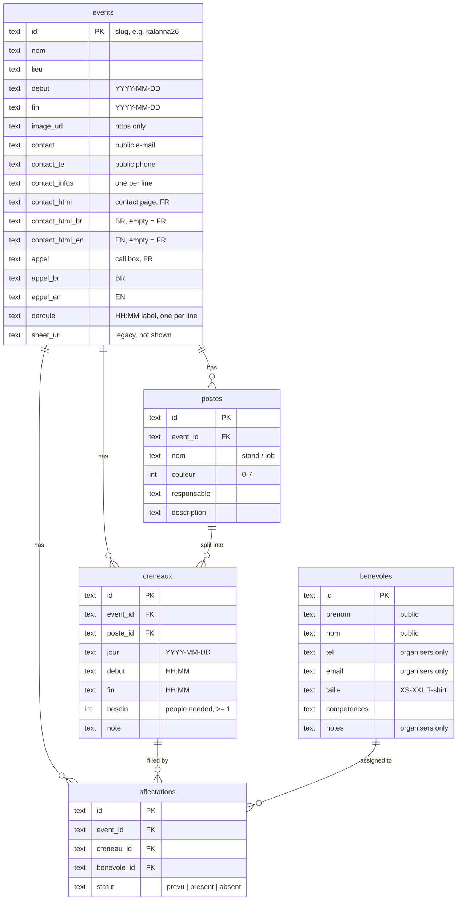
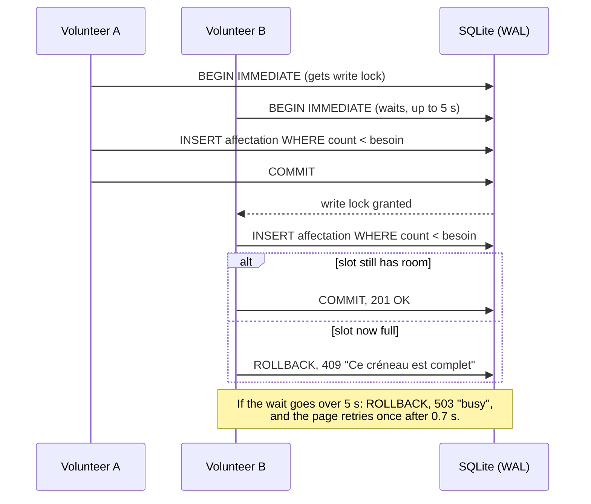

# Database

YOUL VAT stores everything in a single SQLite file, `data/regie.sqlite`, accessed through PHP PDO
(`pdo_sqlite`). There is no database server to install: moving the app to another host means copying
the folder. The schema is plain SQL (`database/schema.sql`) so it can be moved to MySQL later by
changing the DSN in `config.php`.

## Schema

Every table also has `created_at` and `updated_at` (ISO 8601 UTC). Ids are random 16-character hex
strings generated in PHP (`bin2hex(random_bytes(8))`); imported data keeps readable slugs.

| Table | What it holds |
|---|---|
| `events` | One festival edition. Also holds the public contact page and the "Envie de donner un coup de main ?" call box, each in French, Breton and English. |
| `postes` | A stand or job (bar, crêpes, entrance…) with a colour and a person in charge. |
| `creneaux` | A time slot on a poste, with the number of volunteers needed (`besoin`). |
| `benevoles` | A **global directory** of volunteers, reused from one edition to the next. |
| `affectations` | Puts a bénévole on a créneau, with an attendance status for the night. A person can only be on a given créneau once (`UNIQUE (creneau_id, benevole_id)`). |

## Rules

- **Night slots.** A créneau starting before 06:00 belongs to the *night* of its `jour`:
  `jour = 2026-12-31, 00:00–05:00` is the night from the 31st to the 1st. If `fin < debut`, the slot
  goes past midnight. The same logic exists in PHP (`creneau_span()` in `lib/tables.php`) and in JavaScript (`span()`).
- **Filling.** A créneau is full when the number of affectations not marked `absent` reaches `besoin`.
  Public sign-up checks this inside the `INSERT` itself, so two people can never take the last place.
- **Cascades.** Deleting an event, a poste or a créneau deletes everything below it
  (`ON DELETE CASCADE`, with `PRAGMA foreign_keys = ON` on every connection). Deleting a bénévole
  removes their affectations.
- **Privacy.** Volunteer names are public. `tel`, `email` and `notes` are removed from API answers
  unless an organiser is logged in. The event contact fields are public on purpose.
- **Rich text** (`contact_html*`, `appel*`) is cleaned on the server against a tag whitelist
  (`lib/html.php`) and again in the browser before display.

## Life cycle

- **Creation.** On first run, `lib/db.php` creates the file from `database/schema.sql` and, if
  `seed_on_create` is on, loads `seed_file` from `database/`: `seed_demo.sql` (a small English demo
  event, the default) or `seed_kalanna2026.sql` (Fest-noz Vras Kalanna 2026: 24 postes, 56 créneaux).
- **Upgrades.** Columns added after the first version are created automatically on existing
  databases (`migrate()` in `lib/db.php`), so an update by FTP never needs a manual SQL step.
- **Protection.** `data/` and `database/` refuse web access (`.htaccess` + empty `index.php`;
  `protect_dir()` recreates them in `data/` if they go missing).
- **Deploying.** `git ftp push` never uploads `data/regie.sqlite` (it is in `.gitignore`). Uploading
  the whole folder by hand would overwrite the live database.
- **Backups.** Use `export.php` (CSV or full JSON, organisers only). Do not copy `regie.sqlite` by FTP
  while the site is in use: the latest changes may still be in `regie.sqlite-wal`.

## Several people writing at once

SQLite allows one writer at a time. The app relies on three settings to make that painless:

1. **WAL mode** (`PRAGMA journal_mode = WAL`): reading never blocks writing, so the planning page
   reloading every 15–20 s never gets in the way of sign-ups. Some shared hosts with network disks
   refuse WAL; the app then logs a warning once, and logged-in organisers see the actual mode as
   `dbMode` in `api.php?action=all` (`wal` expected).
2. **A 5-second wait** (`PRAGMA busy_timeout = 5000`): a second write waits for the first one
   (which takes about a millisecond) instead of failing.
3. **Transactions that take the write lock first** (`tx()` in `lib/db.php`, `BEGIN IMMEDIATE`).
   Read cursors are closed before, otherwise SQLite fails at once instead of waiting.

